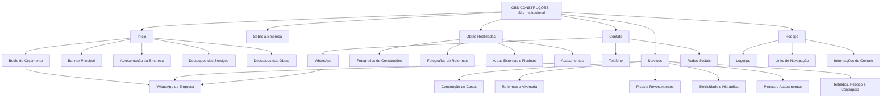

# ARQUITETURA DA INFORMAÇÃO – SITE INSTITUCIONAL OBS CONSTRUÇÕES

**Projeto:** Site institucional da OBS Construções  
**Área:** Construção civil  
**Público-alvo:** Pessoas maiores de 18 anos interessadas em construir, reformar ou realizar melhorias em imóveis.  
**Objetivo:** Apresentar a empresa, divulgar seus serviços, demonstrar trabalhos realizados e facilitar o contato com possíveis clientes.

## 1. Visão geral da arquitetura

A arquitetura da informação foi planejada para que o visitante consiga encontrar rapidamente aquilo que procura, sem precisar navegar por várias páginas ou menus complicados.

Para a primeira versão, a recomendação é desenvolver um **site institucional de página única (One Page)**. Nesse modelo, todas as informações principais ficam organizadas em seções dentro da página inicial, e o menu direciona o visitante diretamente para cada uma delas.

Essa escolha é adequada à OBS Construções porque o principal objetivo do site é divulgar os serviços e facilitar a solicitação de orçamentos.

A estrutura será dividida em cinco áreas principais:

1. Início.
2. Sobre a empresa.
3. Serviços.
4. Obras realizadas.
5. Contato.

O botão de orçamento pelo WhatsApp ficará em destaque durante a navegação.

## 2. Hierarquia das páginas e seções

```text
OBS CONSTRUÇÕES – Site institucional
└── Página inicial
    ├── 01. Início
    │   ├── Banner e apresentação
    │   ├── Destaques dos serviços
    │   └── Destaques das obras
    ├── 02. Sobre a empresa
    │   ├── Apresentação
    │   └── Compromissos e proposta de trabalho
    ├── 03. Serviços
    │   ├── Construção de casas
    │   ├── Reformas e alvenaria
    │   ├── Pisos e revestimentos
    │   ├── Eletricidade e hidráulica
    │   ├── Pintura e acabamentos
    │   └── Telhados, reboco e contrapiso
    ├── 04. Obras realizadas
    │   ├── Construções
    │   ├── Reformas
    │   ├── Áreas externas
    │   └── Acabamentos
    ├── 05. Contato
    │   ├── Telefone
    │   ├── WhatsApp
    │   └── Redes sociais
    └── Rodapé
```

A estrutura não precisa de uma página independente para cada serviço na primeira versão. Isso evita excesso de informações e torna a navegação mais rápida.

## 3. Definição do menu principal

O menu deverá ficar no cabeçalho do site, preferencialmente fixo durante a rolagem da página.

| Menu | Destino | Função |
|---|---|---|
| Início | Página inicial | Apresentar a empresa |
| Sobre | Sobre a empresa | Mostrar informações institucionais |
| Serviços | Nossos serviços | Apresentar o que a empresa realiza |
| Obras | Galeria de obras | Mostrar trabalhos executados |
| Contato | Contato | Apresentar meios de comunicação |
| Orçamento | WhatsApp | Facilitar a contratação |

**Submenus:** Não são necessários na primeira versão. Como o site será de página única, os serviços poderão ser apresentados em categorias dentro da própria seção.

## 4. Descrição do conteúdo de cada página e seção

### 4.1 Início – Página principal

**Prioridade: alta**

É a primeira parte que o visitante visualizará ao acessar o site. Deve causar uma boa impressão e mostrar imediatamente o ramo de atuação da empresa.

**Conteúdo:**
- Logotipo oficial da OBS Construções.
- Menu de navegação.
- Imagem principal de uma casa concluída, preferencialmente uma das obras com piscina enviadas como referência.
- Frase de apresentação: "Sua casa, nosso compromisso."
- Texto curto sobre a qualidade e os serviços da empresa.
- Botão para solicitar orçamento.
- Atalho para conhecer os serviços.

**Principais CTAs:**
- Solicitar orçamento.
- Conheça nossos serviços.
- Veja nossas obras.

### 4.2 Sobre a empresa

**Prioridade: alta**

Essa seção deverá apresentar a OBS Construções e transmitir confiança aos visitantes.

**Conteúdo:**
- Apresentação da empresa.
- Descrição de sua atuação na construção civil.
- Compromisso com qualidade, dedicação e satisfação dos clientes.
- Imagens de construções concluídas.
- Breve apresentação da proposta de trabalho da empresa.

**CTA:** Conheça nossos serviços.

*Observação:* A história, o tempo de atuação e outras informações institucionais deverão ser confirmados pela empresa antes da publicação.

### 4.3 Serviços

**Prioridade: alta**

Essa será uma das seções mais importantes, pois apresentará os trabalhos que podem ser contratados.

Os serviços deverão ser organizados em cards, cada um com um ícone, título, imagem e descrição curta.

| Serviço | Descrição |
|---|---|
| Construção de casas | Construção de residências desde as etapas iniciais até a conclusão. |
| Reformas em geral | Reformas e melhorias em imóveis residenciais. |
| Alvenaria | Construção de paredes e estruturas de alvenaria. |
| Pisos e revestimentos | Instalação de pisos e revestimentos. |
| Serviços elétricos | Instalações e serviços elétricos residenciais. |
| Serviços hidráulicos | Instalações hidráulicas e serviços relacionados. |
| Pintura | Pintura e renovação de ambientes. |
| Acabamentos | Serviços de acabamento e detalhes finais. |
| Reboco e contrapiso | Serviços de reboco e preparação de pisos. |
| Telhados | Serviços relacionados à construção e manutenção de telhados. |
| Serviços gerais de construção civil | Outros serviços relacionados à construção civil. |

**CTA:** Solicitar orçamento para este serviço.

### 4.4 Obras realizadas – Galeria

**Prioridade: alta**

A galeria deverá apresentar fotografias reais dos trabalhos realizados pela OBS Construções.

**Conteúdo:**
- Fotografias de casas concluídas.
- Imagens de reformas.
- Fotografias de áreas externas e piscinas.
- Imagens de etapas de construção.
- Fotografias de acabamentos e revestimentos.

**Organização recomendada:**
- Construções.
- Reformas.
- Áreas externas.
- Acabamentos.

As imagens poderão ser exibidas em cards ou em uma grade organizada. Ao clicar em uma fotografia, o visitante poderá visualizá-la em tamanho maior.

**CTA:** Gostou do resultado? Solicite um orçamento.

### 4.5 Contato

**Prioridade: alta**

A seção de contato deverá permitir que o visitante encontre rapidamente os meios de comunicação com a empresa.

**Conteúdo:**
- Telefone comercial.
- Número de WhatsApp.
- Links para redes sociais oficiais.
- Texto convidando o visitante a solicitar um orçamento.
- Horários de atendimento, caso sejam informados pela empresa.

O telefone informado no material de divulgação é:

**(64) 99320-0246**

**Principais CTAs:**
- Conversar pelo WhatsApp.
- Ligar para a empresa.
- Acessar Instagram.

### 4.6 Rodapé

O rodapé aparecerá no final da página e deverá reunir informações importantes.

**Conteúdo:**
- Logotipo da OBS Construções.
- Nome da empresa.
- Links para as principais seções.
- Telefone e WhatsApp.
- Redes sociais.
- Direitos reservados.

O rodapé também deverá repetir o acesso ao botão de orçamento.

## 5. Navegação entre as páginas

A navegação será feita principalmente por meio do menu superior.

O funcionamento será simples:

1. O visitante acessa o site e visualiza a página inicial.
2. Caso queira conhecer a empresa, seleciona "Sobre".
3. Para visualizar os serviços, seleciona "Serviços".
4. Para conferir trabalhos realizados, seleciona "Obras".
5. Se desejar contratar algum serviço, seleciona "Contato" ou o botão "Solicitar orçamento".
6. Ao clicar no botão de orçamento, será direcionado ao WhatsApp da empresa.

O visitante também poderá navegar pela página utilizando a rolagem normal, sem precisar voltar ao início.

## 6. Principais botões e chamadas para ação (CTAs)

| Botão | Localização | Ação |
|---|---|---|
| Solicitar orçamento | Cabeçalho | Abrir WhatsApp |
| Conheça nossos serviços | Banner principal | Ir para Serviços |
| Ver nossas obras | Página inicial | Ir para Galeria |
| Saiba mais | Sobre | Ir para Serviços |
| Solicitar orçamento | Cards de serviços | Abrir WhatsApp |
| Ampliar imagem | Galeria | Visualizar fotografia |
| Fale conosco | Contato | Abrir WhatsApp |
| Instagram | Rodapé | Abrir perfil oficial |

O botão de WhatsApp deverá receber destaque visual, utilizando o amarelo/dourado da identidade da marca ou um destaque próprio de ação, mantendo contraste adequado.

## 7. Funcionalidades futuras

As funcionalidades abaixo poderão ser adicionadas posteriormente, sem necessidade de alterar a estrutura principal do site.

| Funcionalidade | Descrição | Prioridade |
|---|---|---|
| Formulário de orçamento | Cliente informa seus dados e serviço desejado | Média |
| Painel administrativo | Permite atualizar imagens e informações | Média |
| Depoimentos | Exibe avaliações de clientes | Média |
| Páginas individuais de serviços | Apresenta detalhes de cada serviço | Baixa |
| Mapa de localização | Mostra localização ou área de atendimento | Baixa |
| Notícias e dicas | Publicações sobre construção e reformas | Baixa |
| Integração com redes sociais | Exibe conteúdos das redes da empresa | Baixa |

Essas funcionalidades não são necessárias para o lançamento inicial, mas poderão melhorar a experiência do visitante futuramente.

## 8. Mapa do site (Sitemap em Mermaid)

O diagrama abaixo representa a organização completa da primeira versão do site e suas principais conexões.



## 9. Recomendações de UX/UI Design

Para manter uma boa experiência de navegação, recomenda-se seguir estas orientações:

### Identidade visual
- Utilizar preto, dourado e branco como cores principais.
- Manter o logotipo em destaque no cabeçalho.
- Utilizar elementos gráficos relacionados à construção civil.
- Evitar excesso de efeitos visuais.

### Organização
- Manter o menu simples e visível.
- Utilizar títulos objetivos.
- Separar os serviços em cards.
- Dar destaque às fotografias reais das obras.
- Manter os botões de contato fáceis de encontrar.

### Experiência em dispositivos móveis
- Adaptar o menu para celulares.
- Organizar os cards em uma coluna ou grade responsiva.
- Utilizar botões grandes o suficiente para facilitar o toque.
- Disponibilizar acesso rápido ao WhatsApp.

### Imagens
- Priorizar fotografias reais fornecidas pela empresa.
- Utilizar a casa concluída com piscina como imagem de destaque.
- Evitar misturar fotografias de obras inacabadas com imagens de acabamento final sem identificar cada etapa.

## 10. Considerações finais

A arquitetura da informação da OBS Construções foi planejada para apresentar a empresa de maneira profissional, organizada e objetiva.

A escolha de um site de página única facilita a navegação e permite que o visitante encontre rapidamente os serviços, conheça as obras realizadas e entre em contato para solicitar um orçamento.

A estrutura também permite futuras ampliações, como páginas individuais de serviços, formulário de orçamento e painel administrativo.

**Resultado esperado:** um site institucional moderno, visualmente atrativo, responsivo e fácil de utilizar, que valorize os trabalhos realizados pela OBS Construções e ajude a empresa a conquistar novos clientes.

---

*Documento elaborado como etapa de arquitetura da informação, servindo de referência para a próxima fase de prototipação das telas e desenvolvimento do site.*
